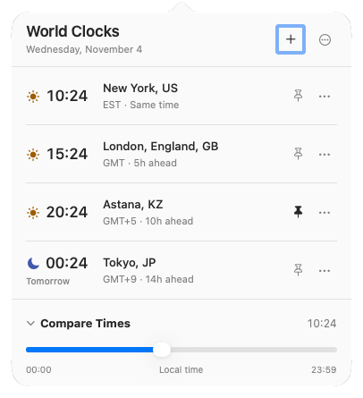

# Clock Tower

Clock Tower is a native macOS menu bar app for comparing times across cities. Pin the clocks you want to see all day, then click the menu bar to search, edit clocks, or preview another time. City search and time conversion work offline.

<picture>
  <source media="(prefers-color-scheme: dark)" srcset="Docs/world-clocks-dark.png">
  
</picture>

## Install

Requires **macOS 15 Sequoia or later**. The same ZIP runs on Apple Silicon and Intel.

1. Download [Clock-Tower-1.1.0-universal-mac.zip](https://github.com/frankstallone/clock-tower/releases/download/v1.1.0/Clock-Tower-1.1.0-universal-mac.zip). To verify it, download the [checksum](https://github.com/frankstallone/clock-tower/releases/download/v1.1.0/Clock-Tower-1.1.0-universal-mac.zip.sha256) to the same folder and run `shasum -a 256 -c Clock-Tower-1.1.0-universal-mac.zip.sha256` there.
2. Double-click the ZIP in Finder. Move **Clock Tower.app** to **Applications**, then open it. Its clocks appear in the menu bar; it has no Dock icon. You can leave Hovrly running.
3. This release is **ad-hoc signed and not notarized**. If macOS blocks the downloaded app, try opening it once, then use **System Settings → Privacy & Security → Open Anyway** for Clock Tower. See [Apple’s instructions](https://support.apple.com/en-us/102445).

## Use the clocks

- Click **+** or press **⌘N** to add a city. Type a city, country, or time zone. Click a result, or use the arrow keys and Return. Escape returns to your clocks.
- Read down the time column to compare cities. The sun and moon distinguish daytime and nighttime. **Tomorrow** and **Yesterday** mark a city whose date differs from yours.
- Click a pin to show that clock in the menu bar. Open the row’s **…** menu or Control-click the row to rename, move, or remove it. Pinned clocks follow the list order. When the last pin is removed, a clock icon still opens the list.
- Expand **Compare Times** and drag the slider to preview another time on your local day. Release to return to now. The menu bar stays live throughout the preview.
- Open **… → Settings…** or press **⌘,** to change the time format, date, compact view, or Open at Login. **View Releases** and **Quit Clock Tower** are also in the options menu.

Astana uses **Asia/Almaty**. At 18:00 UTC on February 29, 2024, its clock went back from 23:59 to 23:00. At 12:00 UTC on November 4, 2026, Astana shows **17:00**. Time-zone rules come from Foundation on macOS. The preview spans the actual local day, including skipped or repeated hours at daylight saving changes.

## Import from Hovrly

On its first launch, Clock Tower reads `~/Library/Application Support/Hovrly/settings.json` if it exists. It copies the ordered clocks, display names, menu bar pins, and display preferences. Without that file, it starts with Berlin and New York. Clock Tower saves its own copy at `~/Library/Application Support/Clock Tower/settings.json`. Subsequent launches use that copy, even if you remove every clock. Open at login is a separate macOS registration for each app.

Clock Tower does not write to Hovrly’s settings or change its login item. Quit Clock Tower before restoring its settings from a backup. To repeat the import, quit Clock Tower and move its settings file aside, then reopen it.

## Build on a Mac

The release was built with Xcode 27.1. Install Xcode and select its command line tools. From the project directory:

```sh
swift test
Scripts/package.sh
```

The script builds both architectures, signs the bundle ad hoc, and writes the ZIP and its SHA-256 file to `dist/`. The app uses SwiftUI, AppKit, Foundation, and ServiceManagement. It requires no third-party runtime or network service.

Clock Tower ports the behavior of [Hovrly 2.4.6](https://github.com/frankstallone/hovrly/releases/tag/v2.4.6). The application code is [MIT licensed](LICENSE). The offline catalog adapts the [GeoNames cities15000 database](https://www.geonames.org/) under [CC BY 4.0](https://creativecommons.org/licenses/by/4.0/); the bundle includes the data license and source details.
